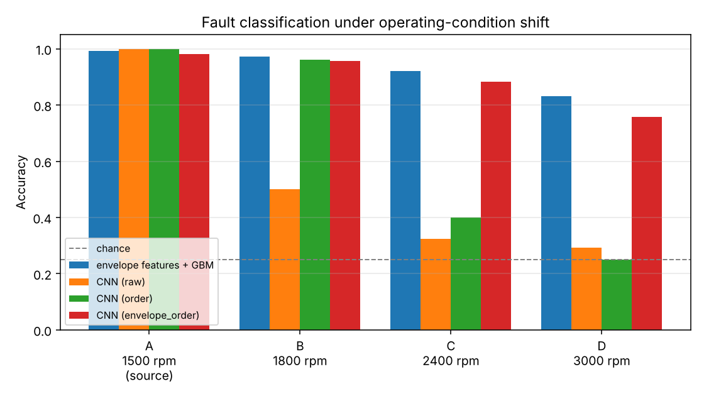
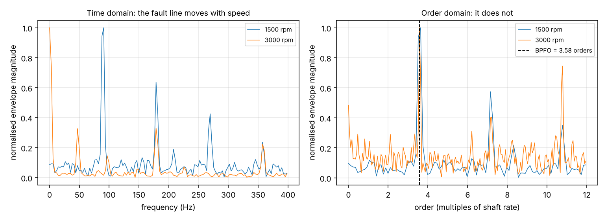
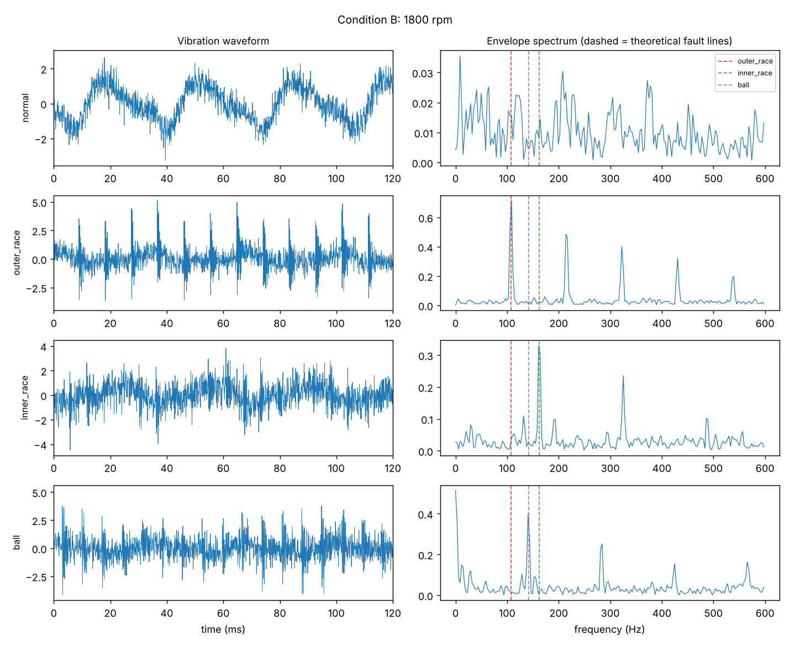

# Bearing fault diagnosis under operating-condition shift

Detect rolling-element bearing faults from vibration, and measure what happens
when the machine changes speed, which is the thing that actually breaks
predictive-maintenance models in the field.

A 1D CNN reaches **100% accuracy on the speed it was trained at and 29% at
double that speed**, barely above the 25% chance line. The same network on a
physically-motivated representation holds **76%**. A classical
envelope-analysis baseline holds **83%**.



---

## The problem with reported accuracy in this field

Published bearing-diagnosis papers routinely report 99%+ accuracy. Two things
usually produce that number:

1. **Windows from one long recording are split at random**, so overlapping
   slices of the same run land in both train and test. The model matches
   recordings, not faults.
2. **Train and test share one operating condition.** The machine runs at the
   same speed and load in both, so the model can key on absolute frequencies
   that happen to be constant.

Real machinery does not hold still. A variable-frequency drive changes shaft
speed constantly, and every bearing fault frequency scales with it. This repo
is built to measure the cost of that: train at one speed, test at four.

| Condition | Shaft speed | Load |
|---|---:|---:|
| **A** (source) | 1500 rpm | 0.25 |
| B | 1800 rpm | 0.50 |
| C | 2400 rpm | 0.75 |
| D | 3000 rpm | 1.00 |

Four classes: **healthy, outer-race fault, inner-race fault, ball fault.**

## Results

Every model trains on condition A only. All numbers are on held-out test
records; chance is 0.25.

| Model | A (source) | B | C | D | Worst drop |
|---|---:|---:|---:|---:|---:|
| Envelope features + gradient boosting | 0.993 | 0.972 | 0.922 | **0.832** | 0.161 |
| CNN on raw vibration | 1.000 | 0.500 | 0.324 | 0.293 | 0.707 |
| CNN on order-tracked vibration | 1.000 | 0.961 | 0.399 | 0.250 | 0.750 |
| CNN on **envelope** order-tracked vibration | 0.982 | 0.957 | 0.884 | **0.758** | 0.224 |

Three things in that table are worth reading carefully.

The raw CNN is perfect in-domain and useless out of it: 1.000 at A, 0.293
at D. Validated the usual way (one operating condition, random split) it
would ship as a 100% accurate fault detector and then fail silently
the first time the drive changed speed. The in-domain number is not wrong; it
is just measuring something other than fault detection.

Order tracking alone does not fix it, and the reason is interesting.
Resampling from constant time steps to constant shaft *angle* pins the fault
repetition rate: an outer-race fault sits at 3.58× shaft rate whatever the
speed, which this repo verifies to within one FFT bin at all four conditions.



So why does the order-domain CNN still collapse at C and D? Because the fault
rate is not the only thing in the signal. The impacts excite a *structural
resonance*, which rings at a fixed frequency in hertz. A fixed frequency
in hertz is a *moving* frequency in orders:

| Condition | Shaft | A 3.5 kHz resonance, in orders |
|---|---:|---:|
| A | 25 Hz | 140 |
| B | 30 Hz | 117 |
| C | 40 Hz | 88 |
| D | 50 Hz | 70 |

Order tracking fixes the modulation and moves the carrier. The network, which
reads the waveform rather than the fault rate, follows the carrier.

Demodulating first does fix it. Band-pass around the resonance, take the
Hilbert envelope, *then* resample by angle. The carrier is gone, and what
remains, the impact pattern, is genuinely speed-invariant. Worst-case
accuracy goes from 0.293 to 0.758, a 2.6× improvement, from changing the
representation rather than the network. Same architecture, same
hyperparameters, same training data.

The classical baseline still wins out of domain, at 0.832 against 0.758.
That is the honest headline. Hand-built features that evaluate energy at
frequencies *predicted from bearing geometry and measured shaft speed* carry
the invariance by construction, and a network has to learn it from data that
contains only one speed. Given a single operating condition to learn from, the
physics is still the better bet.

## How it works

### The bearing

Geometry is the SKF 6205-2RS JEM used on the drive end of the Case Western
Reserve University test rig. It is a real bearing, so the fault frequencies
are real. The computed multipliers reproduce CWRU's published values exactly,
which the test suite asserts:

| | Computed | CWRU published |
|---|---:|---:|
| BPFO (outer race) | 3.5848 | 3.5848 |
| BPFI (inner race) | 5.4152 | 5.4152 |
| Ball defect (2×BSF) | 4.7134 | 4.7135 |
| FTF (cage) | 0.3983 | 0.3983 |

### The signal model

Following Randall & Antoni's tutorial treatment, a localised defect produces a
train of impacts, each of which rings the structure:

```
x(t) = Σ A(t_i)·s(t − t_i)  +  shaft harmonics  +  broadband noise
t_i  = i / f_fault + jitter
s(t) = exp(−ζ·2π·f_n·t)·sin(2π·f_n·√(1−ζ²)·t)
```

Three details carry the diagnosis:

- Rolling elements slip, so impacts are not exactly periodic
  (~1% jitter). This smears the raw spectrum, which is exactly why envelope
  analysis rather than plain FFT is the industry method.
- Load-zone modulation, which is what separates the fault classes. An
  outer-race defect sits still in the load zone, so its impacts are
  unmodulated. An inner-race defect rotates with the shaft and is modulated at
  shaft rate. A ball defect rotates with the cage and is modulated at FTF.
  Those modulations appear as sidebands, and the feature extractor measures
  them explicitly.
- Severity acts as a nuisance variable, drawn at random and never shown to the
  model, so it cannot use loudness as a proxy for fault type.

Records are 4096 samples at 12 kHz (0.34 s), normalised to unit standard
deviation because accelerometer sensitivity varies between installations.
Background noise puts them at roughly −3 to +6 dB SNR, where incipient faults
actually live.



### The classical baseline

What a vibration engineer computes, in order:

1. Kurtogram band selection: split the spectrum at several resolutions,
   band-pass each candidate, keep the band whose output is most impulsive.
2. Hilbert envelope, then its spectrum: the resonance is a carrier, the
   fault rate is the modulation, and demodulation recovers it.
3. Energy at the frequencies geometry predicts: BPFO, BPFI, 2xBSF and three
   harmonics each, plus the inner-race and ball sidebands, normalised against
   the local noise floor.
4. Time-domain condition indicators: kurtosis, crest factor, impulse and
   clearance factors.
5. Gradient boosting over the resulting 24 features.

The result is a clean diagnostic table. Measured at condition B, averaged over
20 records per class, each value is the envelope-spectrum peak relative to the
background:

| True fault | at BPFO | at BPFI | at ball | kurtosis |
|---|---:|---:|---:|---:|
| healthy | 1.54 | 1.47 | 1.32 | 1.94 |
| outer race | **5.78** | 0.67 | 0.61 | 4.69 |
| inner race | 0.59 | **5.36** | 0.62 | 4.12 |
| ball | 0.62 | 0.75 | **5.84** | 4.37 |

Shaft speed is treated as known, because on real machinery it is: from a
tachometer, an encoder, or the drive itself. That is the asymmetry the whole
experiment measures: the feature model is allowed to use speed, the
raw-waveform CNN is not, and the gap between them is what that knowledge is
worth.

### The networks

One architecture, four strided convolution blocks and a linear head (~27k
parameters), trained identically on three different representations. Keeping
the network fixed is the point: any difference between the rows is caused by
the representation, not by the model.

## Reproducing

```bash
pip install -e ".[dev]"
```

```bash
make all
```

Simulates every condition, fits the baseline, trains all three CNNs, evaluates
across conditions and writes `reports/`. About 20 minutes on 4 CPU cores. No
GPU.

A second experiment ships as a config. Does training on two well-separated
speeds close the gap?

```bash
bfd --config configs/multi_source.yaml data && bfd --config configs/multi_source.yaml train --rep raw
```

Run the tests:

```bash
pytest
```

## What is simulated and what that costs

The vibration is synthetic. CWRU's recordings are hosted somewhere this build
environment cannot reach, so the signals come from the physics model above.
That buys the one thing the experiment needs and real data cannot easily give:
the same bearing, the same faults, the same severities, at four cleanly
separated speeds, with ground truth.

The limits are real:

- The simulator has no unmodelled physics. Real recordings carry gear
  mesh, structural resonances that move with temperature, sensor mounting
  effects and compound faults. The domain gap measured here is a *lower bound*
  on the real one.
- Its speed span is wider than CWRU's. CWRU's four motor loads span
  1730 to 1797 rpm, a 4% spread, far too small to expose this failure. The
  conditions here span 2×, which is ordinary for a variable-frequency drive.
- Four fault classes, one defect each. No compound faults, no gradual
  degradation, no remaining-useful-life estimate.

`src/bfd/dataset.py` is where a CWRU `.mat` loader goes; everything downstream
takes `(N, n_samples)` float32 arrays plus a shaft speed per record.

## Limitations and next steps

- The physics baseline still wins out of domain. The interesting follow-up
  is whether a network trained with *explicit* speed conditioning, feeding
  shaft rate as an input the way the feature model gets it, closes the
  remaining gap.
- Single-source training is the hardest case by design. The multi-source
  config exists but is not in the headline table; training on A and C should
  substantially improve D, and quantifying that is the natural next experiment.
- No severity or remaining-useful-life output. Fault *type* is only the
  first question a maintenance planner asks; "how long have I got" is the
  second, and this does not answer it.
- Shaft speed is assumed known and accurate. Order tracking degrades when
  the tachometer is noisy, and that sensitivity is unmeasured here.

## Layout

```
src/bfd/
  geometry.py   bearing geometry and characteristic fault frequencies
  simulate.py   impact-train vibration model with load-zone modulation
  envelope.py   kurtogram, Hilbert envelope spectrum, order tracking
  features.py   24 physics-informed features
  baseline.py   envelope features + gradient boosting
  models.py     the 1D CNN
  train.py      training loop, shared by all representations
  dataset.py    per-condition datasets and the three representations
  evaluate.py   cross-domain scoring and the domain-gap summary
  plots.py      figures
  config.py     typed config loaded from YAML
  cli.py        `bfd <stage>`
tests/          78 tests, including the CWRU-multiplier and order-invariance checks
```

## References

- Randall & Antoni, *Rolling element bearing diagnostics — a tutorial*,
  Mechanical Systems and Signal Processing, 2011.
- Antoni & Randall, *The spectral kurtosis: application to the vibratory
  surveillance and diagnostics of rotating machines*, MSSP, 2006.
- Case Western Reserve University Bearing Data Center, bearing geometry and
  published fault-frequency multipliers.
- Zhao et al., *Deep learning algorithms for rotating machinery intelligent
  diagnosis: an open source benchmark study*, ISA Transactions, 2020. On how
  much published accuracy survives an honest split.

## Licence

MIT.
